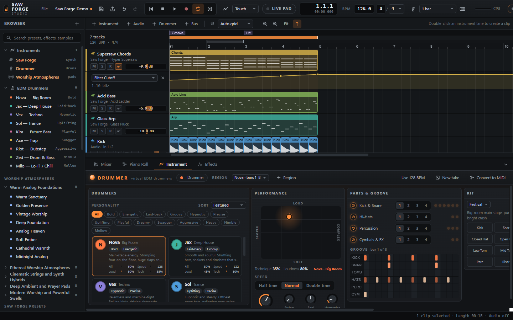
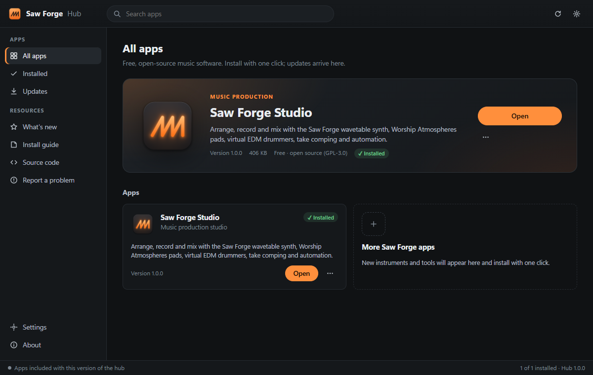

<p align="center">
  
</p>

<h1 align="center">Saw Forge</h1>

<p align="center">
  <b>Free, open-source music production for Windows and macOS.</b><br>
  A wavetable synth, worship pads, virtual EDM drummers, recording and mixing,<br>
  installed and kept up to date by Saw Forge Hub.
</p>

<p align="center">
  <a href="https://github.com/TylerMedlin/saw-forge/releases/latest"></a>
  <a href="https://github.com/TylerMedlin/saw-forge/actions/workflows/ci.yml"></a>
  <a href="LICENSE"></a>
  
  <a href="https://github.com/TylerMedlin/saw-forge/releases"></a>
</p>

<p align="center">
  <a href="https://tylermedlin.github.io/saw-forge/"><b>Download</b></a> ·
  <a href="https://tylermedlin.github.io/saw-forge/install.html">Install guide</a> ·
  <a href="docs/GUIDE.md">User guide</a> ·
  <a href="CONTRIBUTING.md">Contributing</a>
</p>

<p align="center">
  
</p>

## What's inside

**Saw Forge Studio** is a complete music studio in one window:

- **Saw Forge synth.** Two editable wavetable oscillators built from analog-style saws, a supersaw engine, filters, effects and presets.
- **Worship Atmospheres.** Sustaining pads and string layers, with Live Pad Mode and setlists for running a service.
- **Drummer.** Nine virtual EDM drummers you pick by personality, then shape with technique, loudness, fills and speed.
- **Recording.** Audio and MIDI, punch in/out, take lanes and comping.
- **Mixing.** Buses, sends, inserts, automation lanes and WAV export.

**Saw Forge Hub** is the app you install. It installs, updates and opens the Saw Forge apps, checks each download against its published checksum, and keeps your projects in `Documents/Saw Forge`.

<p align="center"></p>

## Download

| | |
|---|---|
| **Windows 10 / 11** (64-bit) | `SawForgeHub-Setup-<version>-win-x64.exe`, a setup wizard |
| **macOS 12 or later** (Apple Silicon and Intel) | `SawForgeHub-<version>-mac-universal.dmg`, drag to Applications |

Get the latest version from the **[download page](https://tylermedlin.github.io/saw-forge/)** or
**[Releases](https://github.com/TylerMedlin/saw-forge/releases/latest)**. The
[install guide](https://tylermedlin.github.io/saw-forge/install.html) walks through every screen,
including the one-time prompt Windows and macOS show for apps that aren't code-signed yet.

Every release is built by GitHub Actions from this repository and comes with
`SHA256SUMS.txt`. App packages are reproducible, so you can rebuild one and get the same checksum.
See [SECURITY.md](SECURITY.md).

## Run from source

**In a browser.** This is the quickest way to work on the music app. You need Python 3 and Chrome or Edge.

```
python serve.py
```

Then open http://127.0.0.1:8765. Engine and workflow tests run at http://127.0.0.1:8765/tests/.

**As the desktop app.** You need Node.js 22 or later.

```
cd desktop
npm ci
npm run pack-apps
npm start
```

`npm run selftest` installs, boots and saves into every app headlessly, and `npm run dist:win` /
`npm run dist:mac` builds the installers. Releasing is described in [docs/RELEASING.md](docs/RELEASING.md).

## Project layout

```
index.html, src/, styles/   Saw Forge Studio (plain ES modules, Web Audio, no build step)
tests/                      engine and workflow tests (browser), file-store tests (Python)
serve.py                    local server for running Studio in a browser
desktop/                    Saw Forge Hub: Electron shell, hub UI, app packer, installers
site/                       download website (GitHub Pages)
docs/                       user guide, release process
.github/workflows/          CI self-tests, releases, website
```

How everything works, from the audio engine to the validation results, is in
**[docs/GUIDE.md](docs/GUIDE.md)**.

## Contributing

Bug reports, ideas and pull requests are welcome. See [CONTRIBUTING.md](CONTRIBUTING.md).
Please report security issues privately as described in [SECURITY.md](SECURITY.md).

## License

Saw Forge is free software. You can redistribute it and/or modify it under the terms of the
[GNU General Public License v3](LICENSE), or (at your option) any later version. It comes with
ABSOLUTELY NO WARRANTY.
